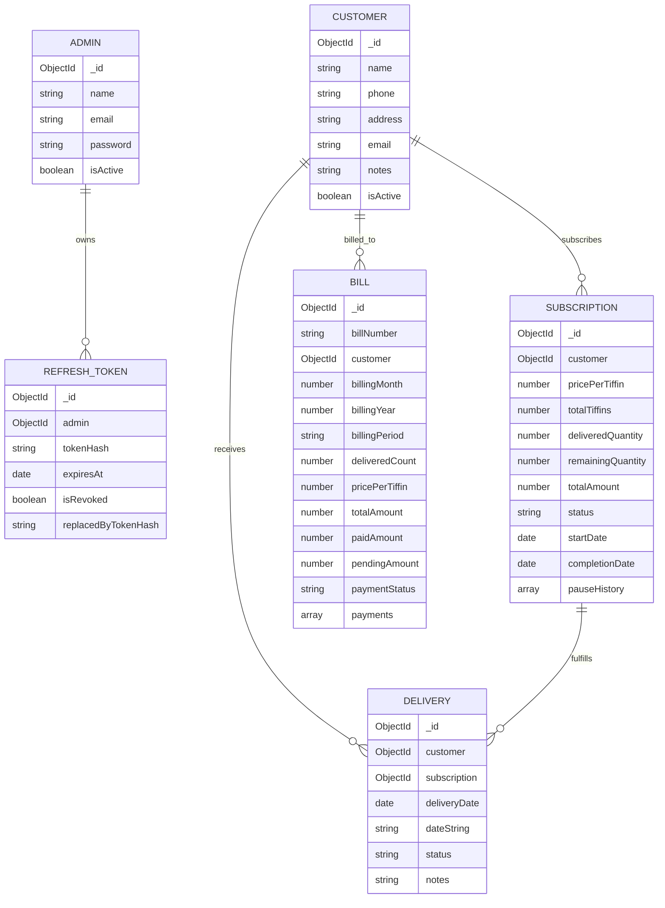

# Software Requirements Specification (SRS)
## Tiffin Management System (TMS)

**Document Version:** 1.0.0  
**Status:** Approved / Implemented  
**Date:** November 2026  
**System Type:** Backend RESTful Application  

---

## Table of Contents

1. [Introduction](#1-introduction)
   - 1.1 Purpose
   - 1.2 Document Conventions
   - 1.3 Intended Audience
   - 1.4 Project Scope
   - 1.5 Definitions, Acronyms, and Abbreviations
2. [Overall Description](#2-overall-description)
   - 2.1 Product Perspective
   - 2.2 Product Functions
   - 2.3 User Classes and Characteristics
   - 2.4 Operating Environment
   - 2.5 Design and Implementation Constraints
   - 2.6 Assumptions and Dependencies
3. [System Features & Functional Requirements](#3-system-features--functional-requirements)
   - 3.1 Authentication & Session Management
   - 3.2 Customer Management
   - 3.3 Subscription & Package Management
   - 3.4 Daily Delivery Management
   - 3.5 Monthly Billing & Manual Payment Management
   - 3.6 Receipt Generation
   - 3.7 Business Dashboard & Aggregated Analytics
4. [External Interface Requirements](#4-external-interface-requirements)
   - 4.1 Software Interfaces
   - 4.2 Communication Protocols & API Standards
   - 4.3 Standard API Response Structure
5. [Data & Database Requirements](#5-data--database-requirements)
   - 5.1 Data Models & Relationships
   - 5.2 Indexing & Integrity Constraints
6. [Non-Functional Requirements](#6-non-functional-requirements)
   - 6.1 Security Requirements
   - 6.2 Reliability & Fault Tolerance
   - 6.3 Performance & Scalability
   - 6.4 Maintainability & Code Quality
7. [System Installation & Operational Procedures](#7-system-installation--operational-procedures)
   - 7.1 Prerequisites
   - 7.2 Environment Configuration
   - 7.3 Database Setup with Docker Compose
   - 7.4 Admin Initialization
   - 7.5 Build & Execution Commands
8. [API Collection & Testing Reference](#8-api-collection--testing-reference)

---

## 1. Introduction

### 1.1 Purpose
This document specifies the software requirements for the **Tiffin Management System (TMS)** backend. It describes the functional requirements, domain rules, data architecture, security specifications, and operational parameters necessary to support the operational distribution of daily meals (tiffins) to hostel students, working professionals, and subscription-based customers.

### 1.2 Document Conventions
- **MUST / SHALL**: Mandatory requirement.
- **SHOULD**: Recommended design choice.
- **MAY**: Optional or configurable item.
- Code identifiers, HTTP methods, and routes are presented in `monospace`.

### 1.3 Intended Audience
- Backend Engineers and Maintainers.
- Mobile Application Developers (React Native client).
- Quality Assurance and Integration Engineers.
- Business Administrators.

### 1.4 Project Scope
The Tiffin Management System backend automates operational and financial tracking for tiffin delivery enterprises. It provides endpoints for customer onboarding, meal package lifecycle management, daily delivery tracking with atomic meal balance deductions, monthly bill generation, manual cash/UPI payment recording, and shareable receipt formatting. The system operates as a standalone headless RESTful service decoupling all UI logic from the business engine.

### 1.5 Definitions, Acronyms, and Abbreviations
- **TMS**: Tiffin Management System.
- **Tiffin**: A prepared meal packaged for delivery.
- **Package / Subscription**: A prepaid or committed pool of tiffins (e.g., 60 meals) consumed on delivery.
- **SRS**: Software Requirements Specification.
- **JWT**: JSON Web Token.
- **TTL**: Time-To-Live (automated data expiration).
- **Idempotency**: Property of operations that produce the same result regardless of repeated execution.

---

## 2. Overall Description

### 2.1 Product Perspective
TMS serves as the core business logic and transactional backend for meal logistics. It provides RESTful APIs consumed by administrative tools and native mobile client applications (React Native). It persists data into MongoDB running containerized via Docker.

```
+-----------------------------------------------------------+
|          Client Layer (Mobile App / Admin Tool)           |
+-----------------------------------------------------------+
                             |  JSON / HTTPS (Bearer JWT)
                             v
+-----------------------------------------------------------+
|                   TMS Backend Engine                      |
|  - Routes & Middleware (Helmet, CORS, Zod Validation)     |
|  - Controllers & Services (Business Rules & Balances)     |
|  - Repositories (Data Abstraction Layer)                  |
+-----------------------------------------------------------+
                             |  Mongoose ODM (Port 27017)
                             v
+-----------------------------------------------------------+
|               MongoDB Storage (Containerized)             |
|   (Admins, Sessions, Customers, Packages, Deliveries, Bills)
+-----------------------------------------------------------+
```

### 2.2 Product Functions
1. **Administrative Authentication**: Secure authentication using access tokens and rotating refresh tokens.
2. **Customer Master**: Centralized register of meal recipients with active/inactive statuses.
3. **Meal Package Tracking**: Non-calendar-bound packages that decrement strictly upon delivery.
4. **Pause/Resume Engine**: Customer leave management preserving meal balances.
5. **Daily Delivery Operations**: Batch delivery dispatching and status updates (`PENDING`, `DELIVERED`, `SKIPPED`, `FAILED`).
6. **Billing & Ledger**: Monthly billing calculated on delivered meals, tracking partial/full payments.
7. **Shareable Receipts**: Formatted data payloads for native sharing (WhatsApp/SMS).
8. **Business Dashboard**: Real-time aggregated key performance indicators.

### 2.3 User Classes and Characteristics
- **System Administrator**: Full administrative access to manage customers, packages, deliveries, finances, and system settings.
- **Clients/Consumers**: Represented only as customer entities; no direct customer portal login is permitted in this version.

### 2.4 Operating Environment
- **Operating System**: Linux / macOS / Windows.
- **Runtime Environment**: Node.js v20.x or v22.x LTS.
- **Database**: MongoDB v5.x+ (Dockerized container).
- **Container Engine**: Docker Engine 24+ and Docker Compose v2+.

### 2.5 Design and Implementation Constraints
- **Separation of Concerns**: Strict MVC + Service + Repository layer pattern.
- **Uniform Envelope**: All responses must use the established JSON response contract.
- **Package Completion Constraint**: Meal packages MUST NOT expire based on calendar duration. Completion occurs strictly when `remainingQuantity == 0`.
- **Payment Gateway Constraint**: No automated third-party payment gateway (Stripe/Razorpay) is integrated; all payments are manually verified and recorded by administrators.

### 2.6 Assumptions and Dependencies
- Single admin tenancy per deployment.
- System time synchronized using UTC / local standard time.
- Network stability between backend and containerized MongoDB instance.

---

## 3. System Features & Functional Requirements

### 3.1 Authentication & Session Management
- **FR-AUTH-1 (Login)**: Administrator shall authenticate using email and password. Upon verification, the system issues an `accessToken` (15-minute TTL) and a `refreshToken` (7-day TTL).
- **FR-AUTH-2 (Token Rotation)**: Use of a refresh token shall generate a new access token and a new refresh token, while revoking the former.
- **FR-AUTH-3 (Reuse Detection)**: If an already-revoked refresh token is presented, the system shall treat it as a breach and invalidate all active sessions for that administrator.
- **FR-AUTH-4 (Storage Security)**: Refresh tokens must be stored in MongoDB strictly as cryptographic SHA-256 hashes.
- **FR-AUTH-5 (Logout)**: Administrator can revoke the current refresh token or revoke all active sessions across devices.
- **FR-AUTH-6 (Password Management)**: Administrator can update credentials by validating the current password. Changing passwords revokes all active sessions.

### 3.2 Customer Management
- **FR-CUST-1 (Onboarding)**: Administrator can register customers with Name, Phone, Address, Optional Email, and Notes.
- **FR-CUST-2 (Phone Uniqueness)**: System shall enforce unique 10-digit Indian mobile numbers (`/^[6-9]\d{9}$/`).
- **FR-CUST-3 (Customer Search & Filter)**: System supports regex-based searching across name, phone, and address, along with active/inactive filtering and pagination.
- **FR-CUST-4 (Deactivation Protection)**: Customers with an `ACTIVE` or `PAUSED` package cannot be deactivated until packages are completed or cancelled.
- **FR-CUST-5 (Data Preservation)**: Permanent database deletion of customers with delivery or financial history is prohibited.

### 3.3 Subscription & Package Management
- **FR-PKG-1 (Package Creation)**: A package consists of `customerId`, `pricePerTiffin`, `totalTiffins`, and optional `startDate`. Total cost (`pricePerTiffin * totalTiffins`) is computed strictly on the backend.
- **FR-PKG-2 (Single Active Package Constraint)**: A customer cannot have more than one `ACTIVE` or `PAUSED` package simultaneously.
- **FR-PKG-3 (Balance Rules)**:
  $$\text{remainingQuantity} = \text{totalTiffins} - \text{deliveredQuantity}$$
  Balances decrease strictly upon successful delivery, never calendar day increments.
- **FR-PKG-4 (Pause Mechanism)**: An `ACTIVE` package can be marked `PAUSED` with an optional expected resume date and reason. During a pause, the package is ineligible for daily deliveries.
- **FR-PKG-5 (Resume Mechanism)**: A `PAUSED` package can be resumed to `ACTIVE` status without forfeiture of remaining tiffins.
- **FR-PKG-6 (Package Completion)**: When `remainingQuantity` reaches 0, the system automatically transitions package status to `COMPLETED` and sets `completionDate`.

### 3.4 Daily Delivery Management
- **FR-DEL-1 (Daily Generation)**: System provides an endpoint to batch-generate daily delivery records with status `PENDING` for all customers with `ACTIVE` packages for a target date.
- **FR-DEL-2 (Idempotent Generation)**: Re-running daily generation for the same date must not create duplicate deliveries. Enforced by a compound unique index on `{ customer: 1, dateString: 1 }`.
- **FR-DEL-3 (Status Progression)**: Deliveries support statuses: `PENDING`, `DELIVERED`, `SKIPPED`, `FAILED`.
- **FR-DEL-4 (Atomic Delivery Deduction)**: Transitioning to `DELIVERED` atomically decrements package `remainingQuantity` and increments `deliveredQuantity`. Fails if remaining quantity is 0.
- **FR-DEL-5 (Deduction Reversal)**: Transitioning from `DELIVERED` back to `SKIPPED`, `FAILED`, or `PENDING` restores 1 meal to `remainingQuantity` and reactivates a `COMPLETED` package if balance is restored.
- **FR-DEL-6 (Non-Consuming Statuses)**: Deliveries marked `SKIPPED`, `FAILED`, or `PENDING` never consume meal balances.

### 3.5 Monthly Billing & Manual Payment Management
- **FR-BILL-1 (Bill Generation)**: Monthly bills are generated from aggregated `DELIVERED` meal records within the calendar month (`YYYY-MM`).
- **FR-BILL-2 (Historical Pricing Integrity)**: Bill calculation uses the package rate active during the delivery period:
  $$\text{totalAmount} = \text{deliveredCount} \times \text{pricePerTiffin}$$
- **FR-BILL-3 (Idempotent Billing)**: Re-running monthly billing for an existing period syncs unbilled meal changes if no payments exist, without generating duplicate bills (enforced by `{ customer: 1, billingPeriod: 1 }`).
- **FR-BILL-4 (Manual Payment Recording)**: Administrator records payments specifying `amount`, `paymentMethod` (`CASH`, `UPI`, `BANK_TRANSFER`, `CHEQUE`, `OTHER`), optional `transactionReference`, and date.
- **FR-BILL-5 (Overpayment Protection)**: Payment amounts cannot exceed `pendingAmount`.
- **FR-BILL-6 (Payment Status)**:
  - `UNPAID`: $\text{paidAmount} = 0$
  - `PARTIAL`: $0 < \text{paidAmount} < \text{totalAmount}$
  - `PAID`: $\text{pendingAmount} = 0$

### 3.6 Receipt Generation
- **FR-REC-1 (Structured Receipt Payload)**: The system provides an endpoint returning structured receipt metadata:
  - Business details (`businessName`).
  - Unique receipt and bill identifiers (`receiptNumber`, `billNumber`).
  - Customer contact details.
  - Billing month and year.
  - Itemized quantities (delivered tiffins, price per tiffin, total amount).
  - Financial summary (paid amount, outstanding pending amount, payment status).
  - Complete payment event history.

### 3.7 Business Dashboard & Aggregated Analytics
- **FR-DASH-1 (Real-Time Metrics)**: Provides an aggregated operational overview without fetching full datasets:
  - Customer counts (active, inactive, total).
  - Package breakdown (active, paused, completed, cancelled, total remaining tiffins).
  - Today's delivery breakdown (pending, delivered, skipped, failed, total).
  - Current month's financials (total billed, total collected, total pending).

---

## 4. External Interface Requirements

### 4.1 Software Interfaces
- **Express 5 API Router**: Manages HTTP request pipelines and route matching.
- **Mongoose 9**: Object Data Modeling (ODM) communication over MongoDB native wire protocol.

### 4.2 Communication Protocols & API Standards
- **Protocol**: HTTP/1.1 or HTTP/2 over TLS.
- **Content Type**: `application/json`.
- **Authentication**: HTTP Authorization Header with Bearer Token scheme:
  ```http
  Authorization: Bearer <access_token>
  ```
- **Base Route**: `/api/v1`

### 4.3 Standard API Response Structure

#### Success Envelope
```json
{
  "success": true,
  "message": "Operation successful",
  "error_code": null,
  "detail": [],
  "payload": { ... }
}
```

#### Error Envelope
```json
{
  "success": false,
  "message": "Validation failed",
  "error_code": "VALIDATION_ERROR",
  "detail": [
    {
      "field": "phone",
      "code": "INVALID_FORMAT",
      "message": "Please enter a valid 10-digit Indian mobile number",
      "location": "body"
    }
  ],
  "payload": null
}
```

#### Error Locations
- `body`: Invalid or missing payload parameters.
- `params`: Invalid URL path parameters (e.g., malformed ObjectId).
- `query`: Invalid search or pagination query parameters.
- `business`: Domain rule violations (e.g., duplicate active packages, insufficient balance).
- `database`: Database unique constraint or persistence conflicts.

---

## 5. Data & Database Requirements

### 5.1 Data Models & Relationships



### 5.2 Indexing & Integrity Constraints
1. **Admins**: `{ email: 1 }` (Unique).
2. **Refresh Tokens**: `{ tokenHash: 1 }` (Index), `{ expiresAt: 1 }` (TTL Index), `{ admin: 1 }`.
3. **Customers**: `{ phone: 1 }` (Unique), `{ isActive: 1 }`, Text index on `{ name, phone, address }`.
4. **Subscriptions**: `{ customer: 1, status: 1 }`, `{ status: 1 }`.
5. **Deliveries**: `{ customer: 1, dateString: 1 }` (Unique compound index preventing double deliveries), `{ dateString: 1, status: 1 }`.
6. **Bills**: `{ customer: 1, billingPeriod: 1 }` (Unique compound index preventing duplicate monthly bills), `{ billNumber: 1 }` (Unique), `{ billingPeriod: 1, paymentStatus: 1 }`.

---

## 6. Non-Functional Requirements

### 6.1 Security Requirements
- Passwords hashed using `bcryptjs` with salt rounds = 10.
- JWT signing keys enforced at a minimum length of 32 characters via Zod validation at startup.
- Rotating refresh tokens with reuse breach detection.
- Refresh tokens hashed with SHA-256 before database persistence.
- HTTP security headers applied globally via `helmet`.
- Cross-Origin Resource Sharing (CORS) configured.
- Sensitive fields (`password`, hash values) omitted from API outputs and logs.

### 6.2 Reliability & Fault Tolerance
- Atomic operations (`findOneAndUpdate` with `$inc` and conditional guards) guarantee package balances remain accurate during concurrent updates.
- MongoDB unique compound indexes prevent duplicate deliveries and monthly bill records.
- Graceful error handling prevents unhandled exceptions from terminating the Express process.

### 6.3 Performance & Scalability
- Aggregation pipelines (`$match`, `$group`) compute statistics directly in the database engine without in-memory collection scanning.
- Paginated results (`page`, `limit`) applied to all list queries to preserve low latency and bounded memory footprint.
- JSON body payload size capped at 1MB.

### 6.4 Maintainability & Code Quality
- Clear 5-tier architecture: **Route → Controller → Service → Repository → Model**.
- Fully typed using strict TypeScript.
- Input validation centralized in declarative Zod schemas.

---

## 7. System Installation & Operational Procedures

### 7.1 Prerequisites
- **Node.js**: `v20.x` or `v22.x`
- **npm**: `v9.x`+
- **Docker**: `24.x`+ with Docker Compose

### 7.2 Environment Configuration
Create the environment configuration file:
```bash
cp backend/.env.example backend/.env
```

Ensure environment variables match your deployment requirements:
```env
NODE_ENV=development
PORT=5000
MONGODB_URI=mongodb://127.0.0.1:27017/tiffin_management
JWT_SECRET=your_super_secret_access_jwt_key_at_least_32_characters
JWT_EXPIRES_IN=15m
JWT_REFRESH_SECRET=your_super_secret_refresh_jwt_key_at_least_32_characters
JWT_REFRESH_EXPIRES_IN=7d
BUSINESS_NAME=Aapka Tiffin Service

ADMIN_NAME=Admin
ADMIN_EMAIL=admin@example.com
ADMIN_PASSWORD=YourStrongPassword123
```

### 7.3 Database Setup with Docker Compose
Start the MongoDB database container:
```bash
# Start MongoDB container in background
docker compose up -d

# Verify container health
docker compose ps

# View container logs
docker compose logs -f mongodb
```

### 7.4 Admin Initialization
Seed the initial administrator account:
```bash
npm --prefix backend run create-admin
```

### 7.5 Build & Execution Commands
```bash
# Install dependencies
npm --prefix backend install

# Verify TypeScript type checks
npm --prefix backend run type-check

# Compile production build
npm --prefix backend run build

# Start development server with live reload
npm --prefix backend run dev

# Start compiled production server
npm --prefix backend start
```

---

## 8. API Collection & Testing Reference

The system includes a complete [Bruno](https://usebruno.com) API collection located in `api-collection/`.

### Directory Structure
```text
api-collection/
  bruno.json
  environments/
    tsm-environment.bru
  health.bru
  auth/
    login.bru
    profile.bru
    refresh-token.bru
    logout.bru
    logout-all.bru
    change-password.bru
  customers/
    create-customer.bru
    get-customers.bru
    get-customer-by-id.bru
    update-customer.bru
    deactivate-customer.bru
  subscriptions/
    create-subscription.bru
    get-subscriptions.bru
    get-subscription-by-id.bru
    get-customer-active-package.bru
    get-customer-package-history.bru
    pause-subscription.bru
    resume-subscription.bru
    cancel-subscription.bru
  deliveries/
    generate-daily-deliveries.bru
    get-daily-deliveries.bru
    get-delivery-by-id.bru
    get-customer-deliveries.bru
    update-delivery-status.bru
  billing/
    generate-monthly-bills.bru
    get-bills.bru
    get-bill-by-id.bru
    get-customer-bills.bru
    record-payment.bru
    get-receipt.bru
  dashboard/
    get-dashboard-summary.bru
```

### Automated Token Flow
The `auth/login.bru` request includes an automated post-response script that sets `token` and `refreshToken` in the active environment. Subsequent authenticated requests automatically inherit the Bearer token without manual token copying.
